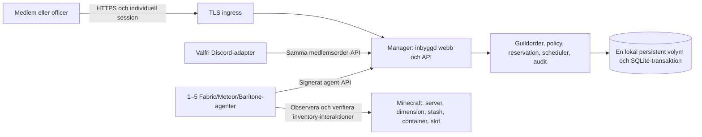

> **Supporterad spelversion:** Minecraft **26.3** och inga andra; Fabric/Meteor/Baritone-klienten använder Java 25 och Manager kör separat med Java 21. Den tidigare 1.21.x-matrisen och dess adapters/recipes stöds inte längre.

# W-025: en Manager, en guild och ett globalt lager

En installation äger exakt en guild och ett gemensamt stashnätverk i en
Minecraft-servervärld, med flera dimensioner och geografiskt spridda stashes.
Alla items tillhör guilden. Medlemmar har identitet, rättigheter och audit;
de har inga privata saldo-/förrådskonton. Webb och API körs i samma Java
Manager-process, med en lokal persistent Docker-volym. Discord är valfritt.
Ingen separat Gringots-backend, obligatorisk PostgreSQL, Mineflayer eller
courier-applikation införs.

Detta dokument är det bindande kontraktet för senare implementationer. Steg 1
bygger driftgrunden. Befintliga JSON-stores är fortsatt baslinjefunktionalitet;
globala reservationer, kvoter, fleet-leases och fysisk E2E är inte redan klara.
Se [ADR-001](adr/001-transactional-guild-storage.md) och
[API-kontrakt](MANAGER_CONTRACTS.md). Dessa delar ska inte aktiveras innan de
har en gemensam transaktionsgräns och konkurrens-/återställningstester.

## Komponenter och tillitsgränser

Manager är auktoritativ för medlemsorder, reserverat saldo, policy/kvoter,
leases/fencing, paket-custody och revisionsbar status. En agent är ett vittne
till vad den senast observerade fysiskt. Ett agentpåstående eller en websocket-
uppdatering är inte bevis för oförändrat inventory eller slutlig mottagning.
Minecraft är en separat felkälla; DB-transaktioner kan inte göra Minecraft-
clicks atomiska. Fysiska operationer kräver intent/kvittens/journal och stopp
vid osäkerhet. Webbläsarens rättighetskontroller är aldrig auktoritativa.

TLS-ingress får endast påverka klient-IP/audit när socketadressen är explicit
betrodd; klientens spoofbara forwardingheaders ger aldrig Owner-bootstrap.
Agentnycklar och medlemscookies är separata identiteter. En agent får aldrig
själv ändra en medlems kvot, roll eller bekräfta mottagning för en annan aktör.

### Rättighets- och interaktionsgränser (PR #94)

- Behörighetsuppdateringar är PATCH-lika för scopes: frånvarande
  `stashes`/`bots`-nycklar behåller befintlig scope; explicit `null` betyder
  obegränsad, `[]` betyder ingen åtkomst (`UserRoutes.update`,
  `Users.Perms.withStashes/withBots`). En rutinmässig flaggändring kan därför
  aldrig vidga åtkomst tyst. Webbläsarens kontroller är aldrig auktoritativa.
- Världsinteraktion kräver exakta tillstånd (position + operation + fullständigt
  namespaced block-ID + auktoriserande jobb + utgång). Jobbet är en verifierad
  gräns: jobbbyte ogiltigförklarar gamla tillstånd, `unknown` auktoriserar
  aldrig, och tillstånd konsumeras inte (samma logiska handling kontrolleras
  flera gånger: mixin, paketgrind, stopDestroy-återkontroll).
  Destruktiva operationer ogiltigförklarar sig själva via blockmatchning
  (break lämnar luft, placering upptar cellen).

## Fysisk källa och global stock

Fysisk nyckel: `(minecraftServerId, dimensionId, stashId, containerId, slot)`.
Container-ID måste skilja en sammanfogad dubbelkista från två observationer av
samma inventory. Slotens fingerprint omfattar itemkomponenter; en hel shulker
har också en containeridentitet och innehållsrevision. Positioner identifierar
plats, inte evig boxidentitet efter flytt/break/place.

Manager accepterar endast nyare scanrevisioner för samma källa. Två agenter
som observerar samma slot skapar inte två lagerrader. Observationen innehåller
`observedAt`, `receivedAt`, revision, agent-ID, fingerprint och verifierad
kvantitet. Klockskew på agenten ger aldrig nyare auktoritet än Manager-revision.

Ett globalt guildsaldo är en vy över distinkta fysiska källor:

| Fält | Betydelse |
|---|---|
| observed | Senast kvitterade fysiska mängd, med revision och källa |
| reserved | Aktiva anspråk på dessa källor för order eller interna jobb |
| available | Allokerbar färsk mängd minus anspråk; aldrig mindre än noll |
| stale/unknown | Ingen säker availability; visas separat, inte som beställbart saldo |
| inTransit | Paket under custody; räknas inte samtidigt som tillgängligt stashlager |

Itemrader och hela shulkers måste låsa samma fysiska resurshierarki. En box och
items inuti den kan inte reserveras oberoende. Intern flytt ändrar plats och
custody; den är inte ett slutligt medlemsuttag och får inte debitera kvoten
igen. Bara en verifierad terminal mottagningshändelse gör det.

## Identiteter och beställning

`guildId` är installationens organisations-ID, aldrig ett användar-ID.
`memberId` identifierar en medlem, `requestedBy` den autentiserade beställaren,
`recipient` den validerade mottagaren och `agentId` ett separat botkonto.
`purpose=SELF` är förvalt; `GUILD` anger ett lagändamål. `comment` är frivillig
för båda och visas som text. Ingen av dessa flaggor skapar privat stock eller
kringgår rättigheter, godkännande eller eventuellt aktiverade kvoter.

Kvoter är av som standard. När de aktiveras reserverar en order kapacitet i
samma transaktion som fysisk stock. Officer-approval konfigureras; normalfallet
är direktbeställning när rollen tillåter den. Mottagare och destination är
separata validerade fält, inte härledda ur fri kommentar.

## Befintlig kod och ansvar vid övergång

| Kod | Återanvändning / gräns |
|---|---|
| `src/main/java/com/porter/wesort/modules/StashSorter`, KitBuilder, OrderRunner | Fysisk scan/sort/repack/pack; behåll algoritmer och verifiera i spel |
| `stash/`, `craft/`, utils och versionsadaptrar | Signkategorier, metadata, kits, anvil, inventory, Baritone, pacing, recovery |
| manager/local/ och Stash Window | Lokal observations-/orderbackend; global medlemsorder ska alltid förmedlas av Manager |
| Manager IndexStore/AddonRoutes | JSON-observation/heartbeat idag; adapter till versionssatta källrevisioner senare |
| Manager OrderStore/OrderRoutes | Befintlig stashorder; får inte parallellt äga framtida guildreservationer |
| Users/AuthRoutes/Signer/AccessControl/AuditLog | Bevara konton, signing, sessioner, scopes och sekretess; framtida roller/audit via samma backend |
| BotHub/BotRoutes | Nuvarande settings/status; hållbara jobbleases införs senare enligt kontraktet |
| StaticRoutes och web/ | React/TypeScript-storefronten (se docs/WEB_ARCHITECTURE.md), samma process och API |

JSON AtomicFiles gör en enskild filersättning atomisk, men ger inte en
transaktion över order + quota + reservation + journal. Därför väljs en
inbäddad SQLite-databas för den framtida domänmotorn, utan separat DB-tjänst.
En versionerad intern WeSort-övergång stänger den gamla skrivvägen innan ny
motor blir auktoritativ. Ingen Qwerte-data läses, konverteras eller importeras.

## Start, stopp och failover

1. Validera egen data-/schemamarkör och ta exklusivt installationslås innan
   tempstädning, nyckelläsning, stores eller HTTP-bindning.
2. Öppna data och auth; vid framtida DB-schema validera/migrera endast WeSort
   inom transaktion. Lås-/schema-/diskfel stoppar start.
3. Återställ journal och leases; fysiskt osäkra operationer markeras
   `NEEDS_RECONCILIATION`. Readiness ges först efter lyckad initiering.
4. Starta webb/API. Genomför Owner-bootstrap genom kortlivad CLI-kapabilitet;
   vanlig logg visar aldrig API-nyckel eller setupcredential.
5. Anslut 1–5 externa agenter och deklarera förmågor. Ingen agent krävs för att
   starta webb eller administrera installationen.
6. Vid SIGTERM: stäng readiness/HTTP-intag, avsluta eller journalför pågående
   serverwrites, stoppa pooler och släpp installationslåset sist.

En HYBRID-agent deklarerar scan, sort, pack, pickup, travel och deliver. Den
claimar jobben i turordning; roller kräver inte separata Minecraft-konton.
Med 2–5 agenter kan samma jobbtyper fördelas, med per-ressurslås, leases och
monotona fencing tokens. Vid 5→1 fortsätter överlevande HYBRID bara säkert
återtagbara jobb. Lease-expiry ger aldrig tillstånd att kopiera ett paket eller
att plocka ny stock när gammal custody är osäker. Ingen automatisk transport
mellan separata Minecraft-servrar ingår.

## Verifiering och roadmapgräns

W-025 verifieras genom arkitektur-/kontraktsreview mot kodtabellen ovan och
ADR:s samtidighets-/crashfall. Runtime-bevis för ingen double spend kräver
W-026/W-024/W-059:s transaktionstester; solo-E2E och failover kräver W-046/047
och Minecraft 26.3. Dessa accepteras inte genom en dokumentationscommit.
W-055 verifierar container/bootstrap/volym/health och W-056 verklig GHCR-
publicering/pull; deras rapporter redovisar separata resultat.
