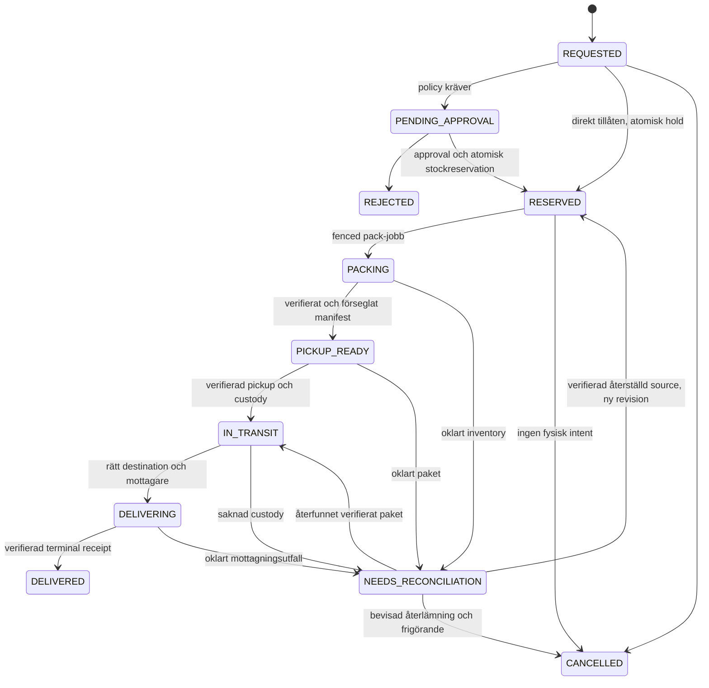

# W-025: interna kontrakt för guildorder och fysiska jobb

Arkitekturkontrakt för W-026–W-040/W-057–059, inte redan registrerade HTTP-
routes. Befintliga `/api/v1`-routes finns i Manager PROTOCOL.md; nya domän-
operationer får inte ärva semantiken att befintlig stashorder `delivered`
automatiskt betyder verifierad medlemsmottagning.

## Orderkommandon

CreateOrder: sessionens `requestedBy` (aldrig fri body-actor), serverns enda
`guildId`, `purpose=SELF|GUILD` (default SELF), frivillig `comment`, typad
`recipient={memberId,minecraftUuid}`, `deliveryMode=CHEST|PLAYER`, registrerat
`destinationId` med revision, `orderLines` (itemfingerprint/kitrevision/antal)
och `idempotencyKey`. En kvitterad order returnerar orderrevision, policyutfall,
state och Manager-tidsstämplar. Kommentar tolkas inte som destination/permission.

ReadStock: global vy samt fysiska källor med observed/reserved/available,
freshness, dimension och sourceRevision. ListOrders/OrderEvents scope: medlem
ser sina tillåtna orders; officers ser den tillåtna guildvyn. Tillgänglighet är
alltid återkontrollerad vid commit; en UI-snapshot reserverar inget.

Approve/Reject/Cancel kräver actor + expectedOrderRevision + idempotencyKey.
Cancel frigör endast bevisligen oanvända holds; fysisk intent/inTransit går
via journal/återställning och blir inte tillgänglig genom statusändring ensam.

## Orderstate machine

REJECTED/CANCELLED/DELIVERED är terminala. Teknisk FAILED före fysisk intent
kan frigöra holds; FAILED efter intent är inte ett lagerutfall utan kräver
reconciliation. `PICKUP_READY` betyder fortfarande warehouse-custody. Delorder
har egna paket och receipts; ordern blir DELIVERED först när alla obligatoriska
rader är kvitterade. Varje kvitto behandlas idempotent.

## Agentkontrakt och journal

HelloAgent: agent-ID, Minecraftkonto-UUID, server/dimension, runtimeversion,
förmågor `{scan,sort,pack,pickup,travel,deliver}`, lokal journalversion. Servern
binder signingcredential till agentidentitet; ingen agent kan påstå en annan
requestedBy. En aktiv agent utför samtliga fysiska steg.

ObserveSource: fysisk nyckel + tidigare sourceRevision + scanID + fingerprint/
slotkvantiteter, observerad tid och bevis för fullständig/partiell scan.
Manager utfärdar nästa revision; saknade slots i partiell scan får inte tolkas
som tomma. Replay och äldre revisioner får inte dubbelräknas.

ClaimJob: agentens förmågor + kapacitet, returnerar jobID, orderID, leaseID,
fence, expiry, förväntade source/destination-revisioner, manifestHash och
tillåtna resourceIDs. Renew kräver samma lease/fence och aktuell journalstatus.
Complete/Fail kräver unik eventID, lease/fence, expectedJobVersion och verifierad
före-/efterbild. Dubblett returnerar samma resultat; konflikt ger 409 och
spärrar fortsatt fysisk exekvering tills agenten reconcilerat.

Journal: `INTENT_RECORDED -> AUTHORIZED -> PHYSICAL_APPLIED -> VERIFIED ->
ACKNOWLEDGED`; oklart utfall i varje steg går till NEEDS_RECONCILIATION.
Receipt innehåller paketID, manifestHash, source/destinationrevision, mottagare,
verifierad mängd och actor/agent-proveniens. Manager måste kunna avvisa en receipt
utan att agenten slänger eller duplicerar inventory.

## En agent och säker återtagning

Samma agent och Minecraftkonto utför scan, sortering, packning, pickup,
transport och leverans. Pickup behöver ett eget custodykvitto även när
samma konto packade boxen. Navigation sker inom den konfigurerade
Minecraft-servern och över dimensioner via verifierade portalövergångar.

När en lease eller kontrollsession tappas behåller Manager paketens
senast verifierade custody. Osäkra intents kräver en ny fysisk
observation och avstämning före återtagning.

## Definitioner av bevis

DB-concurrencytest bevisar inte inventory clicks. API-test bevisar signing,
identity, idempotens och kontraktsvalidering. Minecraft 26.3 E2E med ett konto
ska bevisa verklig scan/pack/pickup/travel och både chest-/player-receipt.
Testmatrisen omfattar även återanslutning, utgången lease och osäkerhetsstopp.
Faktisk 6b6t-drift verifieras separat i #141.
